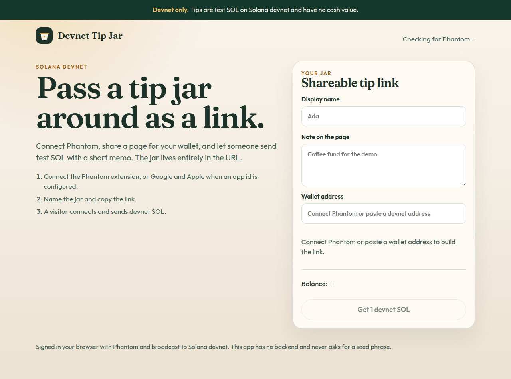
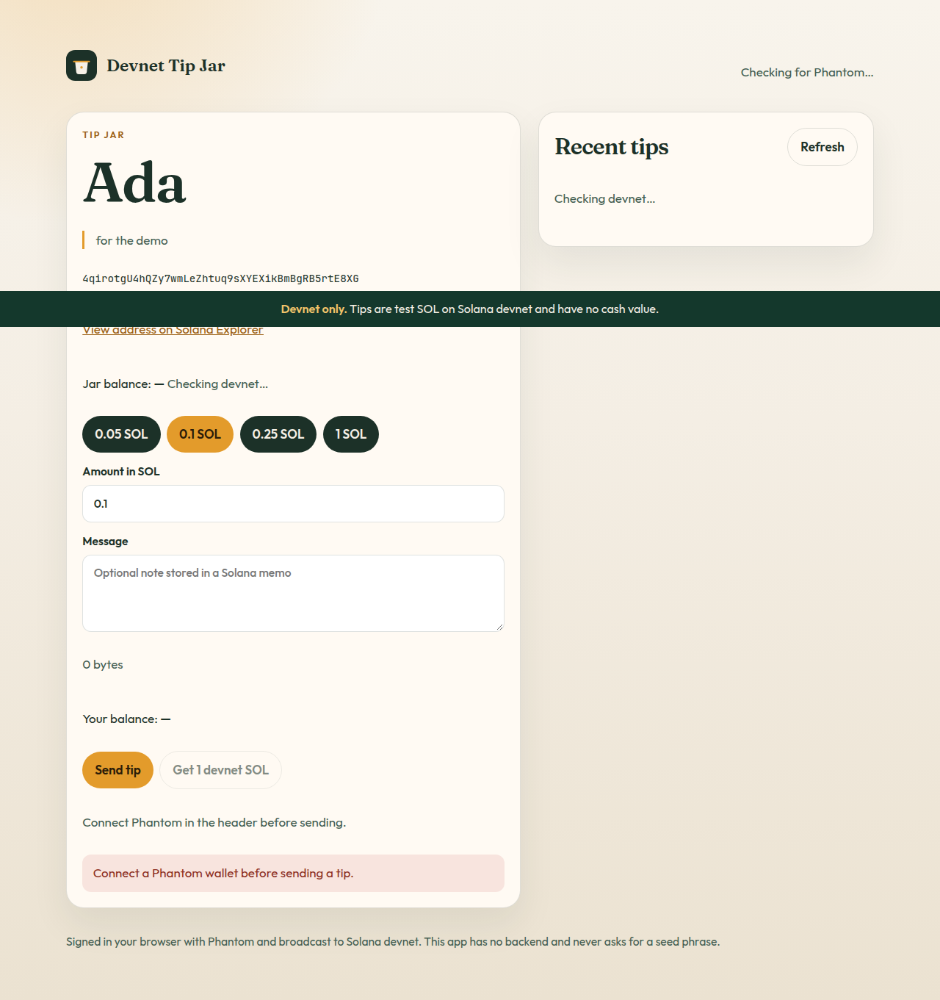
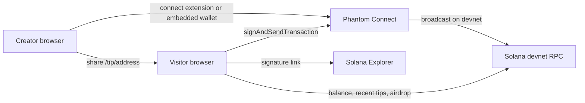

# Devnet Tip Jar

A shareable Solana tip page that stays on **devnet**. A creator connects Phantom, copies a link such as `/tip/<address>?name=Ada&note=for%20the%20demo`, and a visitor opens it, connects Phantom, and sends test SOL with an optional memo.

Demo (after GitHub Pages is enabled): [https://ottonielmorais2008-rgb.github.io/solana-tip-jar/](https://ottonielmorais2008-rgb.github.io/solana-tip-jar/)

The yellow banner on every screen says the tips are test SOL. Explorer links always include `cluster=devnet`.

## Screenshots

Home, where a creator builds a tip link:



Tip page, with amount checks and the devnet explorer link ready once a signature exists:



## Run it

Requires Node.js 22 or newer.

```bash
npm install
cp .env.example .env
npm run dev
```

Open `http://localhost:5173`. The production build uses the GitHub Pages base path `/solana-tip-jar/` and can be checked with:

```bash
npm run build
npm run preview
```

Then open `http://127.0.0.1:4173/solana-tip-jar/`.

Leave `VITE_PHANTOM_APP_ID` empty to use the Phantom browser extension. Google and Apple embedded wallets turn on when that public app id is set. `VITE_SOLANA_RPC_URL` is optional and must be a devnet URL with no API key. See `.env.example`.

In Phantom, switch the wallet to Devnet if it does not switch on its own, then use **Get 1 devnet SOL** if the public faucet allows it. The public airdrop endpoint rate-limits addresses.

## Tests

```bash
npm test
npm run lint
npm run typecheck
npm run build
```

Vitest covers the pure logic: tip-link building and parsing, address checks, SOL-to-lamport conversion, transaction building, fee and balance checks, memo parsing, devnet URL guards, and Phantom provider selection. CI runs lint, typecheck, test, and build.

## Architecture



The browser builds a system transfer and, when the visitor writes a message, a memo instruction. Phantom signs and broadcasts it. Recent tips are parsed from devnet transaction history. There is no server in this repo.

## Technical decisions

**Devnet only.** The RPC helper accepts an endpoint whose host or path contains `devnet` and refuses hosts that contain `mainnet`, plus any URL with a user, password, or key-like query parameter. Explorer URLs are built with `cluster=devnet` and have no other cluster argument. Before a tip is sent, the app calls `switchNetwork('devnet')` and then confirms the signature on the devnet connection. Test SOL has no cash value, which is the right network for a public demo.

**Phantom, with an embedded wallet when an app id exists.** Keys stay inside Phantom. The page never asks for a seed phrase or a private key. The browser extension connects without a Portal app id. Google and Apple are included when `VITE_PHANTOM_APP_ID` is set, which gives visitors an embedded wallet and avoids installing an extension. Embedded wallets only support `signAndSendTransaction`, so that is the only send path.

**No backend.** A tip is a public SOL transfer plus an optional memo. The creator's name and note live in the query string. Balances, airdrops, and recent tips come from the public devnet RPC. A backend would be needed to hide an RPC credential or to hold funds, and this app does neither.

**Security choices.** No private keys, seed phrases, or API keys are committed. Vite variables are shipped to the browser, so `.env.example` is the only env file in git and the RPC helper rejects credentials. The Phantom app id is a public client identifier, not a secret. The wallet shows the transaction before it is signed. Amounts are capped at 5 SOL and must fit in an integer number of lamports. Off-curve addresses are rejected so a tip link has to point at a normal wallet.

## GitHub Pages

The Pages workflow deploys on every push to `main`. Vite's build base is `/solana-tip-jar/`. React Router uses that base, and the build copies `index.html` to `404.html` so a direct visit to `/tip/<address>` still loads the app. `.nojekyll` is included so GitHub Pages serves the asset files as-is.

The repository owner still has to turn the source on once:

1. Merge this branch into `main`.
2. Open **Settings → Pages → Build and deployment** and set **Source** to **GitHub Actions**.
3. Optional: add a repository variable named `VITE_PHANTOM_APP_ID` if you already have a Phantom Portal app, and allowlist `https://ottonielmorais2008-rgb.github.io/solana-tip-jar/` as a redirect URL. New Portal sign-ups are paused, so the extension remains the path that works with a blank app id.

## What went wrong

**`@solana/web3.js` 3.x does not match Phantom.** The current npm `latest` tag is 3.x. Phantom Connect 2.0.4 types `signAndSendTransaction` against the 1.x `Transaction` class. The app pins `@solana/web3.js` to 1.98.4 so the wallet and the transaction builder share one copy.

**Embedded login needs an app id, and new Portal apps are paused.** Phantom's docs say the Portal is not accepting new applications. Google and Apple embedded wallets throw without an app id, while the injected extension does not need one. The provider list is `injected` until `VITE_PHANTOM_APP_ID` is set, and the UI says so.

**`vite preview` ignored the Pages base.** The config first switched the base only when `command === 'build'`. Preview still runs with `command: 'serve'`, so it hosted the site at `/` while `index.html` requested `/solana-tip-jar/assets/...`. Chrome received `index.html` for the script URL and the root stayed empty. The base is now the Pages path for both the build and preview (`isPreview`), and `/` only for `npm run dev`.

**The browser has no `Buffer`.** `TransactionInstruction` data is typed as a Node `Buffer`. After the page loaded, `globalThis.Buffer` was `undefined` in Chrome, which would throw while serializing a tip. `src/polyfill.ts` assigns the `buffer` package to `globalThis.Buffer` before the rest of the app imports web3.js. Reading a balance worked without it; building a transaction would not.

**Decoded lamports came back as bigint.** `SystemInstruction.decodeTransfer` in 1.98 returns `lamports` as a bigint. The first transaction test compared that to a number and failed. The assertion now compares `Number(transfer.lamports)`.
